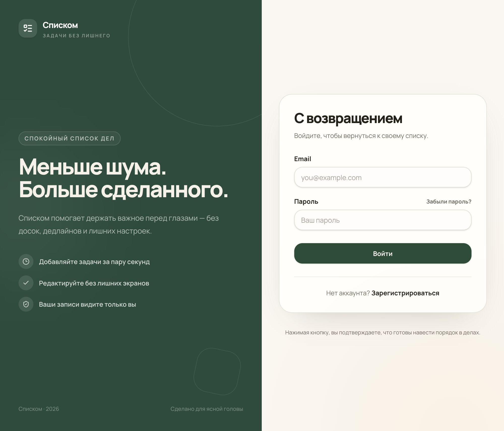
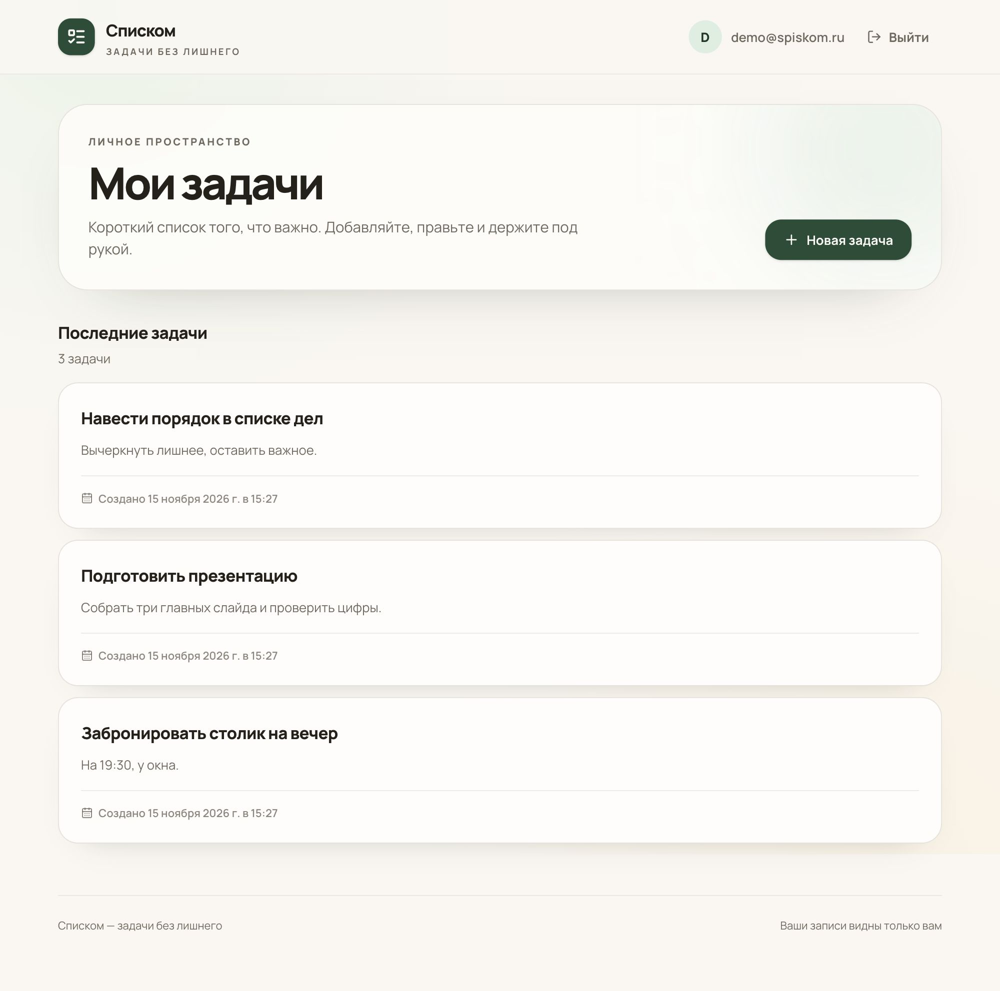

# Списком

**Прод-версия: [spiskom.netlify.app](https://spiskom.netlify.app)**

Спокойный список задач: регистрация, вход, создание, редактирование и удаление записей. Интерфейс полностью на русском, данные пользователя видны только ему.

## Запуск одной командой

Нужен только Docker с Docker Compose. Node.js, PostgreSQL и почтовый сервис устанавливать не нужно.

```bash
./start.sh
```

Приложение: http://localhost:8080 · API: http://localhost:4000/api · письма: http://localhost:8025

База, миграции, API, фронтенд и Mailpit поднимаются автоматически. Настройки читаются из корневого `.env`, шаблон — `.env.example`. Если указан `RESEND_API_KEY`, письма уходят через Resend; иначе остаются в Mailpit.






## Возможности

- Регистрация и вход по email и паролю.
- Выход и восстановление пароля по ссылке из письма.
- Создание задач с заголовком и описанием.
- Отметка задач выполненными с зачёркиванием и сохранением статуса.
- Редактирование и удаление задач.
- Дата создания хранится на сервере и показывается в списке.
- Защищённые маршруты и сессия в `httpOnly` cookie.
- Проверка ввода на клиенте и сервере.
- Адаптивный интерфейс на русском.
- Локальная почта через Mailpit.
- Одна команда для запуска всего стека в Docker.

## Стек

| Слой | Технологии |
| --- | --- |
| Frontend | Preact, Vite, TypeScript, Tailwind CSS, shadcn/ui |
| Backend | Node.js, Express 5, TypeScript, Zod |
| База данных | PostgreSQL, Prisma |
| Авторизация | bcryptjs, JWT, httpOnly cookie |
| Почта | Nodemailer, Mailpit, Resend API или SMTP |
| Деплой | Netlify, Netlify Functions |
| Качество | ESLint, Prettier, Husky, GitHub Actions |

## Подробности запуска

Клонирование и запуск:

```bash
git clone https://github.com/YakovlevCoded/spiskom.git
cd spiskom
./start.sh
```

Или без скрипта:

```bash
docker compose up --build
```

После запуска:

| Сервис | Адрес |
| --- | --- |
| Приложение | http://localhost:8080 |
| API | http://localhost:4000/api |
| Проверка API | http://localhost:4000/api/health |
| Письма Mailpit | http://localhost:8025 |

Первый запуск собирает образы и применяет миграции автоматически. Отдельно создавать базу или таблицы не нужно.

Локальные значения можно изменить в корневом `.env`. Шаблон:

```bash
cp .env.example .env
```

Без `.env` Docker Compose использует те же значения по умолчанию. Если указан `RESEND_API_KEY`, письма уходят через Resend. Без него приложение работает, а письма складываются в Mailpit на http://localhost:8025.

Остановить:

```bash
./stop.sh
```

Удалить контейнеры вместе с локальной базой:

```bash
docker compose down -v
```

## Как проверить сценарии

1. Откройте http://localhost:8080.
2. Зарегистрируйте пользователя.
3. Создайте задачу с заголовком и описанием.
4. Отметьте её выполненной — заголовок и описание зачеркнутся.
5. Отредактируйте её.
6. Удалите задачу и подтвердите действие.
7. Выйдите из аккаунта.
8. Нажмите «Забыли пароль?», укажите email.
9. Откройте письмо в Mailpit и перейдите по ссылке.
10. Задайте новый пароль и войдите с ним.

## Локальная разработка без Docker

Понадобятся Node.js 22+ и PostgreSQL.

```bash
npm install
npm run setup
```

Создайте базу и настройте окружение:

```bash
createdb spiskom
cp backend/.env.example backend/.env
```

В `backend/.env` укажите свои `DATABASE_URL` и `DIRECT_URL`, затем примените миграции:

```bash
npm --prefix backend run db:migrate
```

Запустите API и фронтенд одной командой:

```bash
npm run dev
```

- Vite: http://localhost:5173
- API: http://localhost:4000
- Vite проксирует `/api` на API, поэтому cookie работает как same-origin.

Если SMTP не настроен, письма выводятся в консоль API вместе со ссылкой сброса. Это удобно для локальной проверки без почтового сервиса.

Демо-данные для локального запуска:

```bash
npm --prefix backend run db:seed
```

Тестовые аккаунты:

| Email | Пароль | Что внутри |
| --- | --- | --- |
| `demo@spiskom.ru` | `demo12345` | Три задачи, одна выполнена |
| `test@spiskom.ru` | `test12345` | Пять задач в разных статусах |
| `empty@spiskom.ru` | `empty12345` | Пустой список |

Скрипт можно запускать повторно: задачи не дублируются, а пароли тестовых аккаунтов возвращаются к указанным выше. На production-версии этих аккаунтов нет — там зарегистрируйте свой.

### Почта при локальном запуске

В Docker отдельная настройка не нужна: API отправляет письма в Mailpit, все они видны на http://localhost:8025. Это самый быстрый путь для проверки — без регистраций, ключей и внешних сервисов.

Без провайдера приложение продолжает работать: аккаунт создаётся, вход доступен сразу, письмо после регистрации не отправляется. Сброс пароля в этом режиме недоступен и возвращает понятную ошибку «Отправка писем не настроена».

Если нужна реальная доставка на Gmail, используйте Resend. Ключ настраивается один раз, проверяющему его вводить не нужно:

1. Зарегистрируйтесь на resend.com с тем же Gmail, куда хотите получать письма.
2. Создайте API key и добавьте в `backend/.env`:

```text
RESEND_API_KEY=re_...
MAIL_FROM=Списком <onboarding@resend.dev>
```

3. Проверьте отправку:

```bash
npm --prefix backend run mail:test -- you@gmail.com
```

4. Перезапустите API.

Пока домен не подтверждён, `onboarding@resend.dev` отправляет только на email владельца аккаунта Resend. Для писем любым получателям подтвердите домен и укажите его в `MAIL_FROM`.

Альтернатива — Gmail SMTP. Включите двухэтапную аутентификацию, создайте пароль приложения на https://myaccount.google.com/apppasswords и добавьте в `backend/.env`:

```text
SMTP_HOST=smtp.gmail.com
SMTP_PORT=465
SMTP_USER=your-address@gmail.com
SMTP_PASSWORD=app-password-without-spaces
MAIL_FROM="Списком <your-address@gmail.com>"
```

Обычный пароль Google не подходит. Если Gmail отклоняет отправку, используйте Resend или Mailpit в Docker.

## Переменные окружения

Для Docker используется корневой `.env`, шаблон — `.env.example`. Для нативного запуска API используется `backend/.env`, шаблон — `backend/.env.example`. Готовый шаблон для Supabase и Netlify — `backend/.env.supabase.example`.

| Переменная | Назначение |
| --- | --- |
| `NODE_ENV` | `development`, `test` или `production` |
| `PORT` | Порт API, по умолчанию `4000` |
| `DATABASE_URL` | Подключение Prisma к PostgreSQL |
| `DIRECT_URL` | Прямое подключение для миграций |
| `JWT_SECRET` | Секрет подписи сессии, минимум 32 символа |
| `APP_URL` | Публичный адрес приложения для ссылок в письмах |
| `WEB_ORIGIN` | Origin фронтенда для CORS |
| `COOKIE_SECURE` | `true` для HTTPS, `false` для локального HTTP |
| `SMTP_HOST` | SMTP-сервер |
| `SMTP_PORT` | Порт SMTP |
| `SMTP_USER` | Логин SMTP |
| `SMTP_PASSWORD` | Пароль SMTP |
| `MAIL_FROM` | Отправитель писем |
| `RESEND_API_KEY` | Ключ Resend, альтернатива SMTP |

В Docker все локальные значения заданы в `docker-compose.yml` и могут переопределяться корневым `.env`.

## API

```text
POST   /api/auth/register
POST   /api/auth/login
POST   /api/auth/logout
GET    /api/auth/me
POST   /api/auth/forgot-password
POST   /api/auth/reset-password

GET    /api/todos
POST   /api/todos
PATCH  /api/todos/:id
DELETE /api/todos/:id

GET    /api/health
```

Ошибки возвращаются в формате:

```json
{
  "message": "Понятное описание ошибки",
  "fields": {
    "email": "Введите корректный email"
  }
}
```

## Структура

```text
.
├── .env.example
├── backend/
│   ├── prisma/
│   │   ├── schema.prisma
│   │   └── migrations/
│   ├── src/
│   │   ├── config/
│   │   ├── lib/
│   │   ├── middleware/
│   │   ├── modules/
│   │   │   ├── auth/
│   │   │   └── todos/
│   │   ├── types/
│   │   ├── app.ts
│   │   └── server.ts
│   ├── netlify/functions/api.ts
│   └── Dockerfile
├── frontend/
│   ├── src/
│   │   ├── api/
│   │   ├── app/
│   │   ├── components/
│   │   │   ├── ui/
│   │   │   ├── auth/
│   │   │   ├── todos/
│   │   │   └── layout/
│   │   ├── context/
│   │   ├── hooks/
│   │   ├── lib/
│   │   ├── pages/
│   │   ├── schemas/
│   │   └── types/
│   ├── nginx.conf
│   └── Dockerfile
├── docs/screenshots/
├── scripts/netlify-build.sh
├── docker-compose.yml
├── netlify.toml
├── start.sh
└── stop.sh
```

### Границы ответственности

- `frontend/src/types` — только типы.
- `frontend/src/api` — HTTP-запросы.
- `frontend/src/hooks` — состояние, мутации и формы.
- `frontend/src/components/ui` — shadcn/ui-примитивы и хуки для их поведения.
- `frontend/src/components/todos` и `auth` — презентационные компоненты.
- `frontend/src/pages` — композиция.
- `backend/src/modules/*/routes` — HTTP и валидация.
- `backend/src/modules/*/service` — бизнес-логика и Prisma.
- `backend/src/lib` — общие интеграции.

Компоненты не делают запросы напрямую. Хуки небольшие и отвечают за одно действие.

## Безопасность

- Пароли хранятся как bcrypt-хеши.
- JWT передаётся в `httpOnly` cookie, не в localStorage.
- Cookie `SameSite=Lax`, в production — `Secure`.
- Запросы к задачам всегда фильтруются по текущему пользователю.
- Есть rate limit на авторизацию и восстановление пароля.
- Валидация выполняется на клиенте и повторно на сервере.
- Токен сброса пароля хранится в виде SHA-256-хеша, действует один час и используется один раз.
- Ответ на запрос сброса не раскрывает, существует ли аккаунт.

## Качество кода

```bash
npm run lint
npm run typecheck
npm run format:check
npm run build
```

- ESLint 9 с type-aware правилами.
- Prettier и сортировка Tailwind-классов.
- Сортировка импортов.
- Запрет комментариев в коде через собственное правило ESLint.
- Ограничение размера хуков.
- Husky: pre-commit запускает линтеры, pre-push — проверку типов.
- GitHub Actions проверяет lint, типы и сборку обоих приложений.

## Деплой в Netlify

Проект уже содержит `netlify.toml`, сборку и serverless-функцию API. Фронтенд и API живут на одном домене: запросы `/api/*` идут в функцию, поэтому cookie остаётся first-party.

1. Подключите репозиторий к Netlify.
2. Netlify прочитает команду сборки из `netlify.toml`.
3. Создайте проект в Supabase и откройте **Connect**.
4. Возьмите оттуда две строки:

```text
DATABASE_URL — Transaction pooler, порт 6543
postgresql://postgres.<project-ref>:<password>@<pooler-host>:6543/postgres?pgbouncer=true&connection_limit=1&sslmode=require

DIRECT_URL — Session pooler, порт 5432
postgresql://postgres.<project-ref>:<password>@<pooler-host>:5432/postgres?sslmode=require
```

Хост пулера берите из Connect: его нельзя собрать из региона вручную. Пароль базы — тот, который задавали при создании проекта; спецсимволы в нём нужно закодировать.

5. Добавьте переменные окружения в Netlify:

```text
NODE_ENV=production
DATABASE_URL=<transaction-pooler-url>
DIRECT_URL=<session-pooler-url>
JWT_SECRET=<длинный случайный секрет>
APP_URL=https://spiskom.netlify.app
WEB_ORIGIN=https://spiskom.netlify.app
COOKIE_SECURE=true
MAIL_FROM=Списком <no-reply@spiskom.local>
RESEND_API_KEY=
```

Готовый шаблон: `backend/.env.supabase.example`.

6. Примените миграции к production-базе:

```bash
DATABASE_URL="<transaction-pooler-url>" DIRECT_URL="<session-pooler-url>" npm --prefix backend run db:deploy
```

7. Задеплойте сайт.

Supabase здесь используется только как PostgreSQL. Ключи `sb_publishable_...` и `sb_secret_...` для Data API не нужны: Prisma подключается к базе напрямую по `DATABASE_URL`. Авторизация, API и Prisma остаются внутри проекта. Для локального запуска Supabase не нужен.

## Ограничения

- Нет команд, ролей и совместного доступа.
- Список задач не разбит на страницы.
- Восстановление пароля зависит от настроенного почтового провайдера в production.

## Лицензия

MIT.
