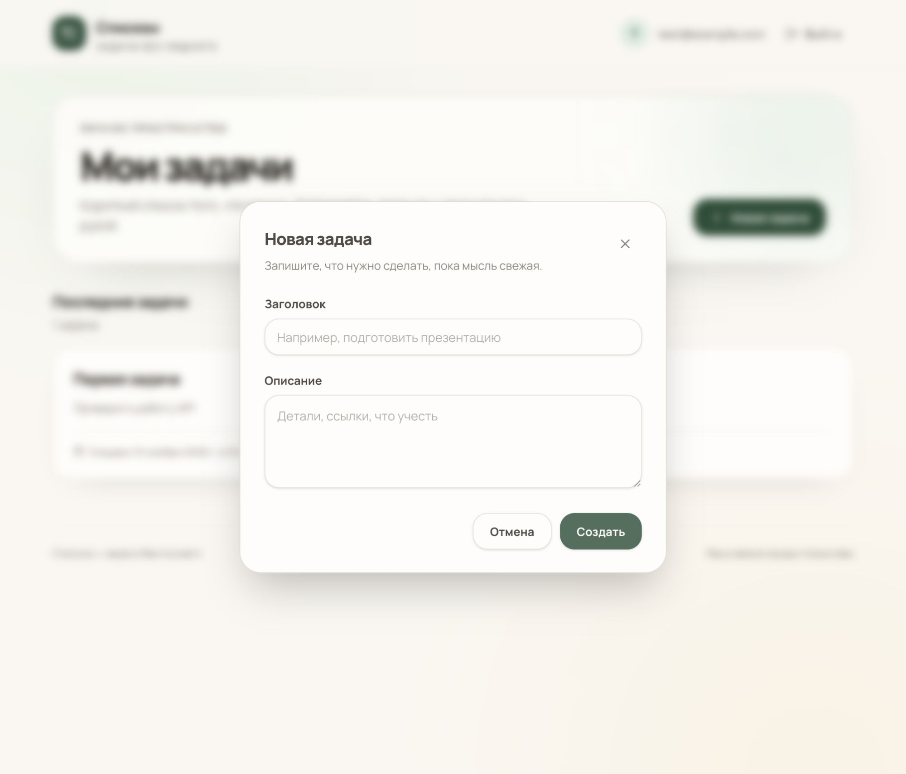

# Списком

**Прод-версия: [spiskom.netlify.app](https://spiskom.netlify.app)**

> На проде работают регистрация, вход и все операции с задачами. Письма через Resend пока в тестовом режиме: до подтверждения домена они уходят только на email владельца аккаунта Resend.

**Прод:** https://spiskom.netlify.app

Спокойный список задач: регистрация, вход, создание, редактирование и удаление записей. Интерфейс на русском, данные пользователя видны только ему.

## Быстрый старт

Нужен только Docker с Docker Compose — Node.js, PostgreSQL и почтовый сервис устанавливать не нужно.

```bash
git clone https://github.com/YakovlevCoded/spiskom.git
cd spiskom
./start.sh
```

| Сервис | Адрес |
| --- | --- |
| Приложение | http://localhost:8080 |
| API | http://localhost:4000/api |
| Проверка API | http://localhost:4000/api/health |
| Письма Mailpit | http://localhost:8025 |

Первый запуск сам собирает образы и применяет миграции. Настройки читаются из корневого `.env`, шаблон — `.env.example`; без `.env` работают значения по умолчанию. Если задан `RESEND_API_KEY`, письма уходят через Resend, иначе остаются в Mailpit.

Остановить приложение:

```bash
./stop.sh
```

Удалить контейнеры вместе с локальной базой:

```bash
docker compose down -v
```




## Деплой в Netlify

Проект уже готов к деплою: `netlify.toml` собирает фронтенд, запросы `/api/*` идут в serverless-функцию, поэтому cookie остаётся first-party.

1. Подключите репозиторий к Netlify — команду сборки Netlify прочитает из `netlify.toml`.
2. Создайте проект в Supabase, откройте **Connect** и возьмите две строки подключения:
   - `DATABASE_URL` — Transaction pooler, порт 6543, с `?pgbouncer=true&connection_limit=1&sslmode=require`;
   - `DIRECT_URL` — Session pooler, порт 5432, с `?sslmode=require`.

   Хост пулера берите из Connect: вручную из региона его не собрать. Спецсимволы в пароле базы закодируйте.

3. Добавьте переменные окружения в Netlify:

```text
NODE_ENV=production
DATABASE_URL="<transaction-pooler-url>"
DIRECT_URL="<session-pooler-url>"
JWT_SECRET="<длинный случайный секрет>"
APP_URL=https://spiskom.netlify.app
WEB_ORIGIN=https://spiskom.netlify.app
COOKIE_SECURE=true
MAIL_FROM="Списком <onboarding@resend.dev>"
RESEND_API_KEY=<ключ Resend или пусто>
```

Готовый шаблон: `backend/.env.supabase.example`.

4. Создайте production-файл и заполните его:

```bash
cp backend/.env.supabase.example backend/.env.production
```

5. Задеплойте одной командой:

```bash
./deploy.sh
```

Скрипт импортирует переменные в Netlify, применит миграции к Supabase и соберёт production-деплой.

Supabase используется только как PostgreSQL. Ключи `sb_publishable_...` и `sb_secret_...` для Data API не нужны: Prisma подключается к базе напрямую по `DATABASE_URL`. Для локального запуска Supabase не требуется.

## Возможности

- Регистрация и вход по email и паролю, выход и восстановление пароля по ссылке из письма.
- Создание задач с заголовком и описанием, редактирование и удаление.
- Отметка задач выполненными: заголовок и описание зачёркиваются, статус сохраняется.
- Дата создания хранится на сервере и показывается в списке.
- Защищённые маршруты и сессия в `httpOnly` cookie.
- Проверка ввода на клиенте и сервере.
- Адаптивный интерфейс на русском.
- Локальная почта через Mailpit и запуск всего стека одной командой.

## Стек

| Слой | Технологии |
| --- | --- |
| Frontend | Preact, Vite, TypeScript, Tailwind CSS, shadcn/ui |
| Backend | Node.js, Express 5, TypeScript, Zod |
| База данных | PostgreSQL, Prisma |
| Авторизация | bcryptjs, JWT, httpOnly cookie |
| Почта | Nodemailer, Mailpit, Resend API или SMTP |
| Деплой | Netlify, Netlify Functions |
| Качество | ESLint, Prettier, Husky, GitHub Actions |

## Локальная разработка без Docker

Понадобятся Node.js 22+ и PostgreSQL.

```bash
npm install
npm run setup
createdb spiskom
cp backend/.env.example backend/.env
```

Укажите свои `DATABASE_URL` и `DIRECT_URL` в `backend/.env`, затем примените миграции и запустите API с фронтендом:

```bash
npm --prefix backend run db:migrate
npm run dev
```

- Vite: http://localhost:5173
- API: http://localhost:4000
- Vite проксирует `/api` на API, поэтому cookie работает как same-origin.

Без настроенного SMTP письма выводятся в консоль API вместе со ссылкой сброса.

### Тестовые аккаунты

Наполните базу демо-данными:

```bash
npm --prefix backend run db:seed
```

| Email | Пароль | Что внутри |
| --- | --- | --- |
| `demo@spiskom.ru` | `demo12345` | Три задачи, одна выполнена |
| `test@spiskom.ru` | `test12345` | Пять задач в разных статусах |
| `empty@spiskom.ru` | `empty12345` | Пустой список |

Скрипт можно запускать повторно: задачи не дублируются, а пароли возвращаются к указанным выше. На production-версии этих аккаунтов нет — там зарегистрируйте свой.

### Почта

В Docker отдельная настройка не нужна: все письма видны в Mailpit на http://localhost:8025. Если почтовый провайдер не настроен, приложение продолжает работать, но сброс пароля возвращает ошибку «Отправка писем не настроена».

**Ограничение тестового задания:** на проде письма работают в ограниченном режиме. Включён Resend с отправителем `Списком <onboarding@resend.dev>`, но его домен не подтверждён, поэтому Resend доставляет письма только на email владельца аккаунта Resend. Регистрация работает всегда, но письмо на чужой адрес не уйдёт, а сброс пароля для чужого адреса вернёт ошибку. Это ограничение тестового окружения, а не логики приложения.

#### Что сделать в Resend, чтобы письма уходили любым получателям

1. Откройте Resend → **Domains** → **Add Domain** и добавьте свой домен.
2. Пропишите DNS-записи SPF и DKIM у регистратора домена.
3. Дождитесь статуса **Verified**.
4. В Netlify замените `MAIL_FROM` на `Списком <no-reply@your-domain.ru>` и обновите `RESEND_API_KEY`, если выпустили новый.
5. Перезапустите деплой.

Проверка отправки:

```bash
npm --prefix backend run mail:test -- you@gmail.com
```

До подтверждения домена эта команда сработает только для email владельца аккаунта Resend. После подтверждения письма будут уходить на любой адрес.

Альтернатива — Gmail SMTP. Включите двухэтапную аутентификацию, создайте пароль приложения на https://myaccount.google.com/apppasswords и добавьте в `backend/.env`:

```text
SMTP_HOST=smtp.gmail.com
SMTP_PORT=465
SMTP_USER=your-address@gmail.com
SMTP_PASSWORD=app-password-without-spaces
MAIL_FROM="Списком <your-address@gmail.com>"
```

Обычный пароль Google не подходит. Если Gmail отклоняет отправку, используйте Resend или Mailpit.

## Переменные окружения

Для Docker используется корневой `.env`, шаблон — `.env.example`. Для нативного запуска API — `backend/.env`, шаблон — `backend/.env.example`. Готовый шаблон для Supabase и Netlify — `backend/.env.supabase.example`.

| Переменная | Назначение |
| --- | --- |
| `NODE_ENV` | `development`, `test` или `production` |
| `PORT` | Порт API, по умолчанию `4000` |
| `DATABASE_URL` | Подключение Prisma к PostgreSQL |
| `DIRECT_URL` | Прямое подключение для миграций |
| `JWT_SECRET` | Секрет подписи сессии, минимум 32 символа |
| `APP_URL` | Публичный адрес приложения для ссылок в письмах |
| `WEB_ORIGIN` | Origin фронтенда для CORS |
| `COOKIE_SECURE` | `true` для HTTPS, `false` для локального HTTP |
| `SMTP_HOST` | SMTP-сервер |
| `SMTP_PORT` | Порт SMTP |
| `SMTP_USER` | Логин SMTP |
| `SMTP_PASSWORD` | Пароль SMTP |
| `MAIL_FROM` | Отправитель писем |
| `RESEND_API_KEY` | Ключ Resend, альтернатива SMTP |

В Docker значения по умолчанию заданы в `docker-compose.yml` и переопределяются корневым `.env`.

## API

```text
POST   /api/auth/register
POST   /api/auth/login
POST   /api/auth/logout
GET    /api/auth/me
POST   /api/auth/forgot-password
POST   /api/auth/reset-password

GET    /api/todos
POST   /api/todos
PATCH  /api/todos/:id
DELETE /api/todos/:id

GET    /api/health
```

Ошибки возвращаются в формате:

```json
{
  "message": "Понятное описание ошибки",
  "fields": {
    "email": "Введите корректный email"
  }
}
```

## Структура

```text
.
├── backend/
│   ├── prisma/          схема и миграции
│   ├── src/
│   │   ├── config/      переменные окружения
│   │   ├── lib/         Prisma, JWT, почта
│   │   ├── middleware/  авторизация
│   │   └── modules/     auth и todos: routes, service, schemas
│   └── netlify/         serverless-функция API
├── frontend/src/
│   ├── api/             HTTP-запросы
│   ├── components/      ui, auth, todos, layout
│   ├── hooks/           состояние, мутации и формы
│   ├── pages/           композиция страниц
│   └── types/           общие типы
├── docs/screenshots/
├── scripts/netlify-build.sh
├── docker-compose.yml
├── netlify.toml
├── start.sh
└── stop.sh
```

### Границы ответственности

- `frontend/src/types` — только типы.
- `frontend/src/api` — HTTP-запросы.
- `frontend/src/hooks` — состояние, мутации и формы.
- `frontend/src/components/ui` — shadcn/ui-примитивы и хуки для их поведения.
- `frontend/src/components/todos` и `auth` — презентационные компоненты.
- `frontend/src/pages` — композиция.
- `backend/src/modules/*/routes` — HTTP и валидация.
- `backend/src/modules/*/service` — бизнес-логика и Prisma.
- `backend/src/lib` — общие интеграции.

Компоненты не делают запросы напрямую. Хуки небольшие и отвечают за одно действие.

## Безопасность

- Пароли хранятся как bcrypt-хеши.
- JWT передаётся в `httpOnly` cookie, не в localStorage.
- Cookie `SameSite=Lax`, в production — `Secure`.
- Запросы к задачам всегда фильтруются по текущему пользователю.
- Есть rate limit на авторизацию и восстановление пароля.
- Валидация выполняется на клиенте и повторно на сервере.
- Токен сброса пароля хранится как SHA-256-хеш, действует один час и используется один раз.
- Ответ на запрос сброса не раскрывает, существует ли аккаунт.

## Качество кода

```bash
npm run lint
npm run typecheck
npm run format:check
npm run build
```

ESLint 9 с type-aware правилами, Prettier с сортировкой Tailwind-классов, сортировка импортов, собственное правило против комментариев в коде и ограничение размера хуков. Husky запускает линтеры на pre-commit и проверку типов на pre-push, GitHub Actions проверяет lint, типы и сборку.

## Ограничения

- Нет команд, ролей и совместного доступа.
- Список задач не разбит на страницы.
- Письма на проде работают в ограниченном режиме: домен Resend не подтверждён, поэтому отправка возможна только на email владельца аккаунта Resend. Это ограничение тестового задания.
- Восстановление пароля зависит от настроенного почтового провайдера в production.

## Лицензия

MIT.
